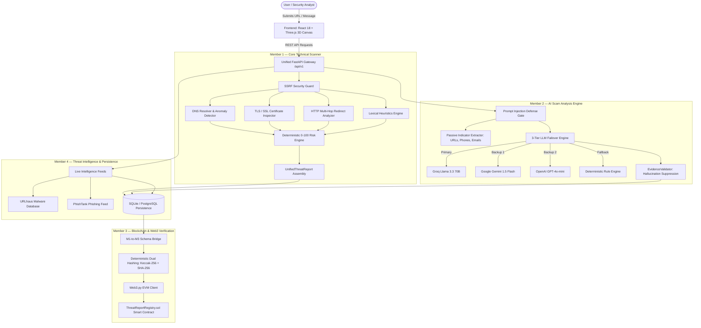

# CyberShield AI — AI-Powered Cyber Threat Intelligence & Digital Trust Platform

[](https://www.python.org/)
[](https://fastapi.tiangolo.com/)
[](https://reactjs.org/)
[](https://www.typescriptlang.org/)
[](https://soliditylang.org/)
[](https://hardhat.org/)
[](https://threejs.org/)
[](https://tailwindcss.com/)
[](LICENSE)

**CyberShield AI** is an enterprise-grade cyber threat intelligence, forensic URL investigation, social engineering scam detection, and blockchain-anchored integrity verification platform. Developed for the Adamas University Hackathon by a collaborative team of 4 engineers, CyberShield AI unifies deterministic network forensics, multi-LLM social engineering analysis, live EVM smart contracts, and real-time threat intelligence feeds into a single, cohesive cybersecurity platform.

---

## 🏛️ Platform Architecture

CyberShield AI is built upon four decoupled yet deeply interoperable pillars:



---

## 🛡️ Core Capabilities by Member

### 🔍 Member 1 — Deep Forensic URL Scanner & Risk Engine
- **Pre-Flight SSRF Guard**: Strictly blocks attacks against loopback (`127.0.0.1`), private RFC 1918 subnets (`10.0.0.0/8`, `172.16.0.0/12`, `192.168.0.0/16`), and cloud metadata IP (`169.254.169.254`).
- **Cryptographic Evidence Normalizer**: RFC 8785 JSON canonicalization guarantees deterministic sorting and hashing of evidence.
- **TLS/SSL Inspection**: Detects weak ciphers, expired certificates, self-signed issuers, and SAN mismatches.
- **HTTP Redirect Chain Tracing**: Unmasks shortened URLs and detects protocol downgrade attacks (HTTPS $\rightarrow$ HTTP).
- **Shannon Entropy & Lexical Heuristics**: Detects Cyrillic homograph attacks, punycode spoofing, and credential harvest keywords.
- **Deterministic Risk Engine**: Bounded 0–100 scoring model mapping evidence into qualitative severity tiers (`CRITICAL`, `HIGH`, `MEDIUM`, `LOW`, `SAFE`).

### 🤖 Member 2 — AI Scam Analysis & Social Engineering Engine
- **Multi-Tier LLM Failover Hierarchy**: **Groq Cloud (Primary)** $\rightarrow$ **Google Gemini Flash (Backup 1)** $\rightarrow$ **OpenAI GPT-4o-mini (Backup 2)** $\rightarrow$ **Deterministic Heuristic Engine (Fallback)**.
- **Zero-Crash Architecture**: Gracefully degrades through the failover ladder without interrupting service if external APIs timeout or hit rate limits.
- **Prompt Injection Defense**: Multi-pattern regex guards neutralize instruction override attacks and system prompt leakage attempts.
- **EvidenceValidator Grounding**: Compares LLM claims against verbatim message content to eliminate hallucinations.
- **Localized Fraud Detection**: Specialized recognition of Indian fraud patterns (UPI payment scams, fake electricity disconnection SMS, malicious APK links).

### ⛓️ Member 3 — Blockchain & Smart Contract Verification
- **Smart Contract (`ThreatReportRegistry.sol`)**:
  - Written in Solidity `^0.8.20`.
  - Dual-tier governance (`onlyOwner` administration + `onlyAuthorized` report registration).
  - Permanent duplicate hash protection (`reportsByHash[reportHash].exists`).
  - Constant gas $O(1)$ lookups and zero external call reentrancy immunity.
- **Dual Hashing Separation**:
  - **Keccak-256**: Used natively for Ethereum EVM `bytes32` contract storage and on-chain event indexing.
  - **SHA-256**: Used for off-chain payload integrity, database tracking, and third-party forensic audits.
- **Cross-Language Hash Parity**: Formally tested across Python 3.11 and TypeScript/JavaScript with IEEE 754 float normalization (`87.0 -> 87`).
- **Dual Mode Execution**: Transparently supports both real on-chain EVM transactions and offline local simulation mode.

### 🌐 Member 4 — Threat Intelligence Feeds & Persistence
- **Live Threat Feeds**: Real-time correlation with the **URLhaus** malware database and **PhishTank** verified phishing feed.
- **Relational Data Persistence**: Relational schema supporting scans, intelligence results, forensic risk reports, and chronological event timelines.
- **Scan History & Search**: Full-text querying by target URL, domain, or message excerpt with multi-filter severity facets.

### 🎨 Frontend — 3D Cinematic Interactive Experience
- **Three.js WebGL Hero Canvas**: Interactive 3D scene with dynamic camera choreography and ambient particles.
- **Fluid Particle Experience**: Custom particle simulation engine responding to user interaction.
- **Modular HUD**: Custom cursor, chapter rail navigation, audio gate modal, and reactive cyber-themed audio feedback.
- **Complete Suite of Application Pages**:
  - `Scanner`: Real-time URL threat inspection.
  - `MessageAnalyzer`: Social engineering text and scam detection.
  - `Dashboard`: Aggregated threat telemetry and system health.
  - `History`: Searchable investigation registry with forensic timelines.
  - `ReportDetail`: Detailed technical findings with blockchain verification cards.
  - `Settings`: API provider configuration and network parameters.

---

## 🚀 Quick Start Guide

### Option 1: One-Click Windows Interactive Launcher (Recommended)
Double-click `CyberShield.bat` in the project root:
- Automatically detects Python and Node.js environments.
- Starts the local Hardhat EVM blockchain node (optional).
- Launches the FastAPI backend server on `http://127.0.0.1:8000`.
- Automatically opens interactive Swagger API documentation in your default browser.

To gracefully stop all running servers:
```cmd
STOP_CyberShield.bat
```

---

### Option 2: Manual Terminal Startup

#### 1. Backend Setup (FastAPI)
```bash
# Navigate to backend directory
cd backend

# Install dependencies
pip install -r requirements.txt

# Copy environment template
cp ../.env.example .env

# Start FastAPI development server
uvicorn app.main:app --reload --host 127.0.0.1 --port 8000
```
- Swagger API Docs: `http://127.0.0.1:8000/docs`
- Health Check: `http://127.0.0.1:8000/api/v1/health`

#### 2. Blockchain Setup (Hardhat Local EVM)
```bash
# Navigate to blockchain directory
cd blockchain

# Install dependencies
npm install

# Start local EVM node (runs on http://127.0.0.1:8545)
npx hardhat node

# In a separate terminal, deploy the smart contract
npx hardhat run scripts/deploy.js --network localhost
```

#### 3. Frontend Setup (React + Vite)
```bash
# Navigate to frontend directory
cd frontend

# Install dependencies
npm install

# Start Vite development server
npm run dev
```
- Web Application: `http://localhost:5173`

---

## 🧪 Automated Testing & Verification

CyberShield AI features **389 automated tests and verifications** with a **100% pass rate**:

| Test Suite | Framework | Count | Scope | Result |
| :--- | :--- | :---: | :--- | :---: |
| **Member 1 Core Scanner** | Pytest | 293 | SSRF, DNS, TLS, redirects, heuristics, risk engine | **293 / 293 PASS** |
| **Member 3 Python Web3** | Pytest | 54 | Hashing, validation, normalization, report IDs | **54 / 54 PASS** |
| **M1 + M3 Integration** | Pytest | 9 | End-to-end investigate, register, verify, tamper | **9 / 9 PASS** |
| **Smart Contract Tests** | Hardhat / Mocha | 22 | Reentrancy, access control, duplicate rejection | **22 / 22 PASS** |
| **Cross-Language Hashing** | Hardhat / Chai | 7 | Bit-level Python $\leftrightarrow$ TypeScript consistency | **7 / 7 PASS** |
| **Live Local EVM Checks** | Web3.py | 4 | Real on-chain deployment, tx status 1, mining | **4 / 4 PASS** |
| **TOTAL VERIFIED CHECKS** | | **389** | Complete full-stack test coverage | **389 / 389 PASS (100%)** |

To execute tests:
```bash
# Run backend Python tests (356 tests)
python -m pytest backend/tests/

# Run smart contract & cross-language tests (29 tests)
cd blockchain && npx hardhat test

# Run live on-chain EVM verification (requires running hardhat node)
python -m tests.verify_live_evm
```

---

## 📡 REST API Reference

| Endpoint | Method | Auth Required | Description |
| :--- | :---: | :---: | :--- |
| `/api/v1/health` | `GET` | No | Subsystem health, DB status, and blockchain mode |
| `/api/v1/reports/investigate` | `POST` | **Yes (`X-API-Key`)** | Run deep forensic technical scan on a URL |
| `/api/v1/reports/register` | `POST` | **Yes (`X-API-Key`)** | Anchors threat report hash to the blockchain |
| `/api/v1/reports/verify` | `POST` | No (Public) | Verifies report integrity against on-chain hash |
| `/api/v1/reports/{report_id}` | `GET` | No (Public) | Retrieve public threat report and audit trail |
| `/api/v1/scans/url` | `POST` | No | Full-stack URL scan with threat intel feeds |
| `/api/v1/scans/message` | `POST` | No | Social engineering scam analysis on text messages |
| `/api/v1/system/providers` | `GET` | No | Operational status of external threat intelligence |

---

## 🔐 Security & Privacy Commitments

- **Zero Hostile Execution**: CyberShield AI inspects network and DNS metadata passively. It never downloads, crawls, or executes hostile payloads.
- **Zero Real Secret Exposure**: All `.env` files, private keys, database credentials, and session tokens are strictly ignored via `.gitignore`.
- **Timing Attack Resistance**: Authentication header validation utilizes constant-time string comparison (`secrets.compare_digest`).
- **Verifiable Audit Trail**: All audit findings, security assessments, and phase verification reports are preserved under [`docs/audit/`](docs/audit/).

---

## 👥 Hackathon Team & Acknowledgements

- **Member 1**: Core Backend Architecture, SSRF Defense, Network Forensics, Deterministic Risk Scoring
- **Member 2**: AI Scam Message Analyzer, Prompt Injection Mitigation, LLM Failover Ladder
- **Member 3**: Blockchain Integration, Solidity Smart Contracts, Deterministic Hashing, Web3.py
- **Member 4**: Threat Intelligence Correlation (URLhaus / PhishTank), Database Persistence, API Contracts
- **Adamas University Hackathon 2026**

---

## 📄 License

This project is licensed under the MIT License — see the [LICENSE](LICENSE) file for details.
