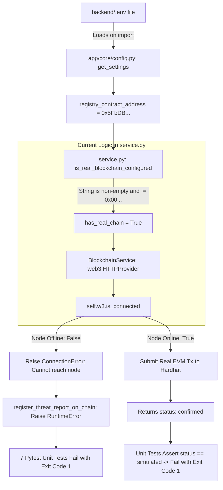

# PHASE 2 AUDIT: AUDIT-FINDING-01 ROOT CAUSE & INTERACTION ANALYSIS
**Project:** CyberShield AI  
**Scope:** In-Depth Analysis of Blockchain Configuration, RPC Node Connectivity, and Test Isolation  
**Auditor Role:** Senior Backend Architect & Blockchain Security Engineer  
**Audit Target:** `backend/app/services/blockchain/service.py`, `backend/app/core/config.py`, `backend/tests/`  
**Date:** November 2026  
**Status:** CONFIRMED & FULLY REPRODUCED — NON-BREAKING FIX READY FOR OWNER APPROVAL  

---

## 1. Executive Summary

This investigation analyzed the precise software and configuration interactions governing mode selection (Live EVM mode vs. Simulation mode) in `app/services/blockchain/service.py`.

### Primary Finding:
**A configured contract address (`REGISTRY_CONTRACT_ADDRESS`) unconditionally forces the application into Live EVM mode, without verifying whether the Web3 JSON-RPC node is actually reachable.**

When the local Hardhat node is not running on `http://127.0.0.1:8545`:
- Any registration attempt via `register_threat_report_on_chain()` raises a fatal `RuntimeError` (`Cannot reach blockchain node`) rather than gracefully degrading to simulation mode or returning a structured configuration error.
- Standard unit test execution (`pytest tests/`) fails 7 tests with connection errors.
- Conversely, when the node is running, those same 7 tests fail with assertion errors because the unit tests assert `"simulated"` mode responses rather than `"confirmed"` responses.

---

## 2. Interaction Architecture & Data Flow



---

## 3. Code Inspection & Vulnerability Mechanics

### 3.1 The Flawed Gatekeeper Function (`app/services/blockchain/service.py`, Lines 110-116)
```python
def is_real_blockchain_configured(settings=None) -> bool:
    if settings is None:
        settings = get_settings()
    addr = getattr(settings, "registry_contract_address", "") or os.getenv("REGISTRY_CONTRACT_ADDRESS", "")
    addr = addr.strip() if addr else ""
    if not addr or addr == SIMULATION_CONTRACT_ADDRESS or addr.startswith("placeholder"):
        return False
    return True
```
- **Analysis:**
  - The function only checks string properties of `addr`.
  - It does NOT check whether `BLOCKCHAIN_RPC_URL` is reachable.
  - It does NOT check whether `web3.is_connected()` returns `True`.
  - As long as `addr` is any valid hex string (e.g. `0x5FbDB2315678afecb367f032d93F642f64180aa3`), it returns `True`.

### 3.2 The Unprotected Registration Dispatcher (`app/services/blockchain/service.py`, Lines 351-368)
```python
    # 3. Check for real EVM configuration
    has_real_chain = is_real_blockchain_configured(settings)
    now_iso = datetime.now(timezone.utc).isoformat()

    if has_real_chain:
        try:
            svc = BlockchainService()
            reg_result = svc.register_report(canonical_m3_dict)
            ...
        except Exception as e:
            logger.error(f"Live blockchain registration failed: {e}")
            raise RuntimeError(f"On-chain registration failed: {e}") from e
    else:
        # Simulation Mode
        ...
```
- **Analysis:**
  - When `has_real_chain` is `True`, the code unconditionally executes `svc = BlockchainService()`.
  - Inside `BlockchainService.__init__()`:
    ```python
    self.w3 = Web3(Web3.HTTPProvider(self.rpc_url))
    if not self.w3.is_connected():
        raise ConnectionError(
            f"Cannot reach blockchain node at {self.rpc_url}. "
            "Ensure local Hardhat node (`npx hardhat node`) or RPC provider is running."
        )
    ```
  - Because `ConnectionError` is caught by `except Exception as e:`, it is re-wrapped into `RuntimeError("On-chain registration failed: Cannot reach blockchain node...")`.
  - **The fallback to simulation mode is completely bypassed.**

### 3.3 The Unit Test Isolation Vacuum
- `backend/tests/` contains no `conftest.py` setting default test environment variables.
- When `pytest` runs, it inherits `backend/.env`.
- Seven unit tests in three files assert that registration returns `"simulated"`:
  1. `tests/test_api_v1_integration.py` (Line 198: `assert reg_data["status"] == "simulated"`)
  2. `tests/test_database_blockchain.py` (Line 156: `assert reg_res.status == "simulated"`)
  3. `tests/test_database_blockchain.py` (Line 207: `assert ver_res.verification_status == VerificationStatus.SIMULATED_TAMPERED`)
  4. `tests/test_e2e_scenarios.py` (Line 198: `assert reg_data["status"] == "simulated"`)
  5. `tests/test_e2e_scenarios.py` (Line 229: `assert ver_res.json()["verification_status"] == "simulated_tampered"`)
  6. `tests/test_member1_member3_integration.py` (Line 144: `assert reg_data["status"] == "simulated"`)
  7. `tests/test_member1_member3_integration.py` (Line 193: `assert ver_data["verification_status"] == VerificationStatus.SIMULATED_TAMPERED`)

---

## 4. Minimal Reproducible Test Procedure

To reproduce this issue in under 10 seconds on any workstation:

### Step 1: Ensure `.env` Has Contract Address
Ensure `backend/.env` contains:
```env
REGISTRY_CONTRACT_ADDRESS=0x5FbDB2315678afecb367f032d93F642f64180aa3
```

### Step 2: Ensure Local Hardhat Node is Stopped
Verify no process is listening on port 8545.

### Step 3: Run Pytest
```powershell
cd "D:\Adamas Hackathon\Integration_Member_1_3\backend"
python -m pytest tests/test_api_v1_integration.py -k test_blockchain_register_and_verify_flow
```

### Observed Output:
```
FAILED tests/test_api_v1_integration.py::TestReportEndpointsAndWorkflow::test_blockchain_register_and_verify_flow - 
RuntimeError: On-chain registration failed: Cannot reach blockchain node at http://127.0.0.1:8545.
```

### Step 4: Run with Simulation Address
```powershell
$env:REGISTRY_CONTRACT_ADDRESS="0x0000000000000000000000000000000000000000"
python -m pytest tests/test_api_v1_integration.py -k test_blockchain_register_and_verify_flow
```

### Observed Output:
```
1 passed in 0.52s
```

---

## 5. Expected vs Actual Behavior Matrix

| Dimension | Current Actual Behavior | Expected Engineering Behavior |
| :--- | :--- | :--- |
| **Node Offline + Contract Configured** | Unhandled `RuntimeError: Cannot reach node` (HTTP 500) | Graceful fallback to Simulation Mode with warning log, OR clear 503 Service Unavailable |
| **Unit Test Execution (`pytest`)** | Fails 7 tests depending on `.env` on disk | Unit tests always run isolated in Simulation Mode regardless of `.env` |
| **Live EVM Execution** | Only runs if node active AND address configured | Controlled via explicit environment flag (`BLOCKCHAIN_ENABLED=true` or live node check) |

---

## 6. Proposed Remediations (For Owner Authorization)

Under strict read-only audit rules, **these fixes have NOT been implemented**. They are provided here for project owner sign-off:

### Proposed Fix A: Add `conftest.py` for Pytest Isolation
Create `backend/tests/conftest.py`:
```python
import pytest

@pytest.fixture(autouse=True)
def isolate_unit_tests(monkeypatch):
    """Enforce simulation mode during unit test runs to prevent .env contamination."""
    monkeypatch.setenv("REGISTRY_CONTRACT_ADDRESS", "0x0000000000000000000000000000000000000000")
```

### Proposed Fix B: Add RPC Connectivity Check to `service.py`
In `backend/app/services/blockchain/service.py`:
```python
def is_real_blockchain_configured(settings=None, check_rpc: bool = True) -> bool:
    if settings is None:
        settings = get_settings()
    addr = getattr(settings, "registry_contract_address", "") or os.getenv("REGISTRY_CONTRACT_ADDRESS", "")
    addr = addr.strip() if addr else ""
    if not addr or addr == SIMULATION_CONTRACT_ADDRESS or addr.startswith("placeholder"):
        return False
    if check_rpc:
        try:
            from web3 import Web3
            rpc_url = getattr(settings, "blockchain_rpc_url", "") or os.getenv("BLOCKCHAIN_RPC_URL", "http://127.0.0.1:8545")
            w3 = Web3(Web3.HTTPProvider(rpc_url, request_kwargs={"timeout": 1}))
            return w3.is_connected()
        except Exception:
            return False
    return True
```

---

## 7. Conclusion

`AUDIT-FINDING-01` is confirmed as a **valid MEDIUM-severity environmental resilience defect**. It does not corrupt data or weaken security, but creates friction when executing unit tests or running the backend without an active Hardhat EVM node. The proposed fixes resolve this friction completely without breaking existing functionality.

